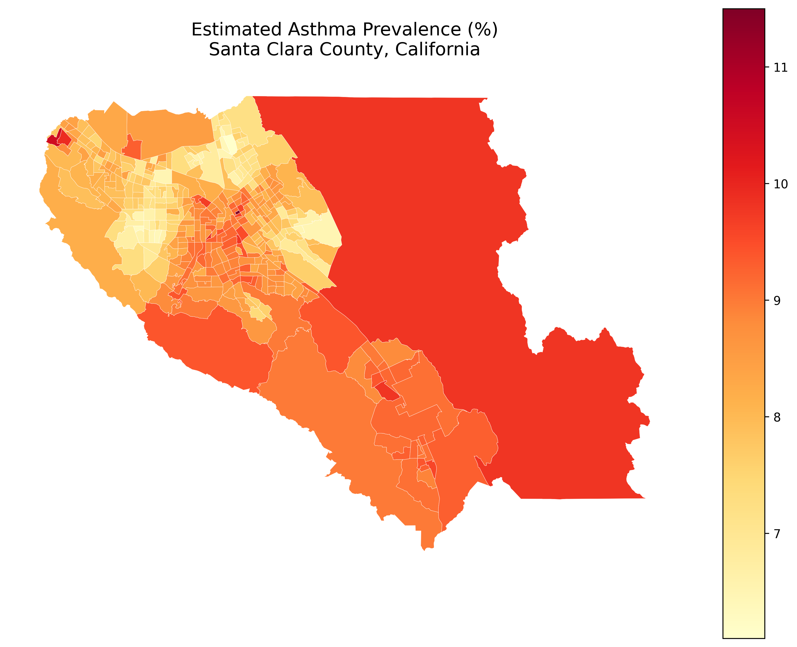
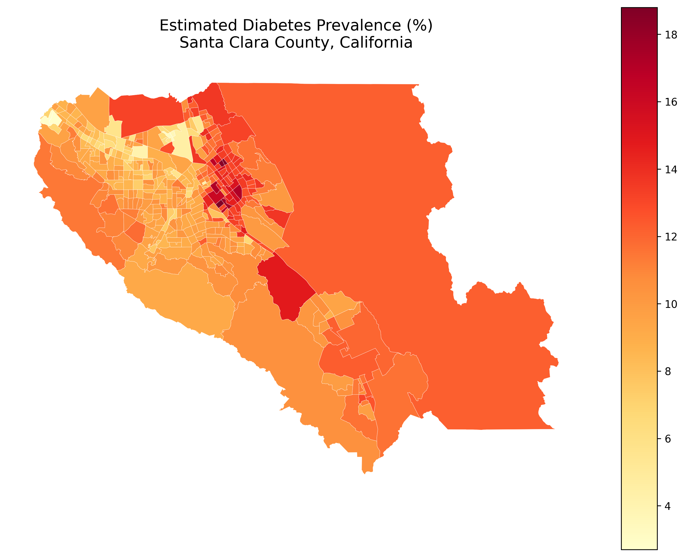
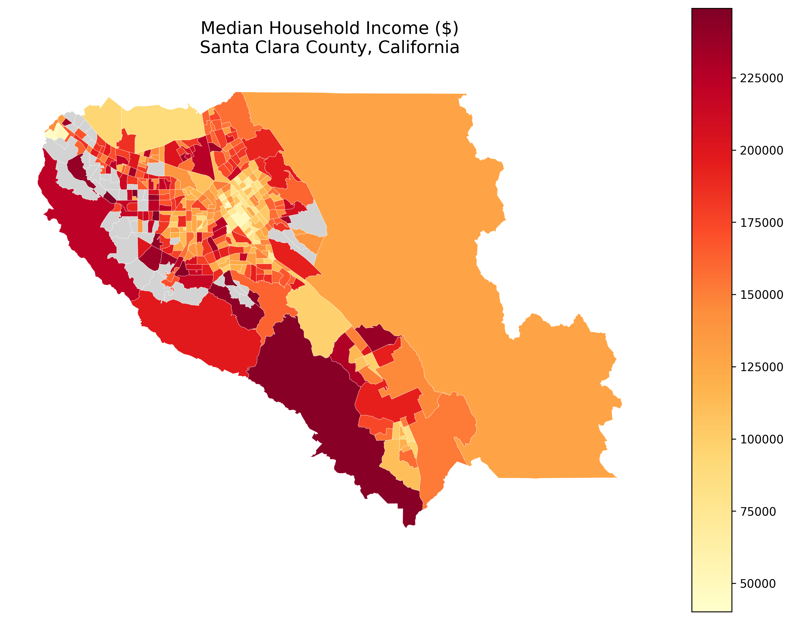
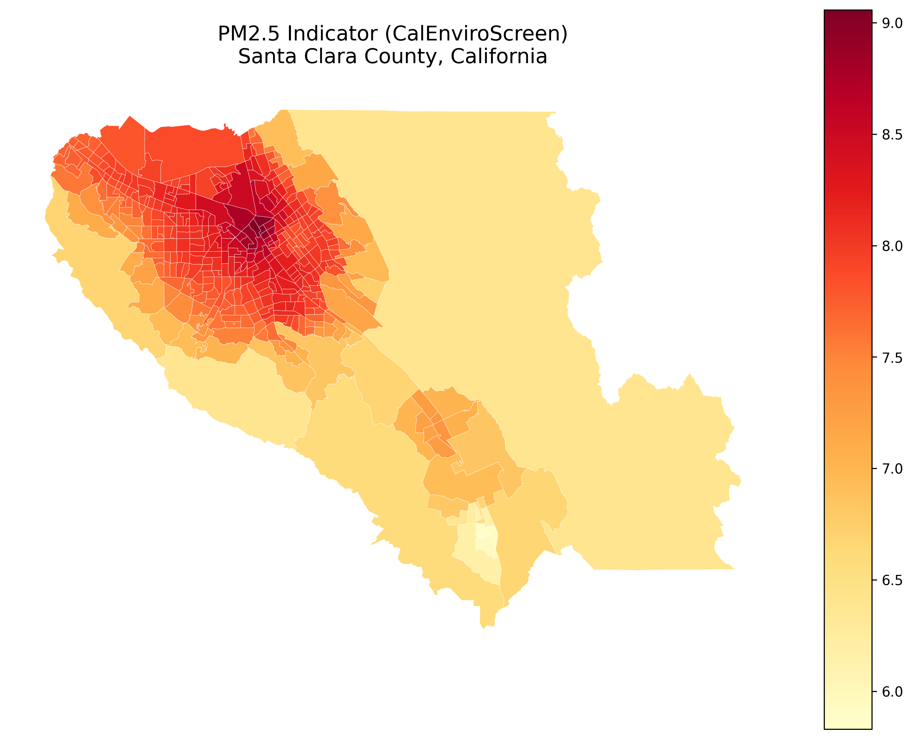

# Environmental Health Research

## About the Project

This project explores the relationship between environmental conditions and public health across California. Using census tract-level data, I am investigating how environmental exposures, socioeconomic factors, and health outcomes may be connected, and whether certain patterns emerge across different communities.

I'm particularly interested in understanding how environmental health disparities appear geographically and how data analysis can help identify them.

## Research Questions

- How are environmental exposures distributed across California?
- Are environmental conditions associated with certain health outcomes?
- Do health outcomes show patterns of geographic clustering?
- How do income and poverty relate to environmental and health disparities?

## Data Sources

This project brings together three primary datasets:

- **CalEnviroScreen:** Environmental exposure and socioeconomic indicators across California communities.
- **CDC PLACES:** Local estimates of health outcomes at the census tract level.
- **American Community Survey (ACS):** Demographic and socioeconomic data, including income and poverty.

The datasets were cleaned and combined using census tract GEOIDs, resulting in a matched dataset of 408 census tracts.

## Methods

I used Python to clean, organize, and analyze the datasets. My analysis includes:

- Exploratory data analysis and geographic visualization
- Pearson and Spearman correlation coefficients to examine relationships between variables
- Global Moran's I to investigate spatial autocorrelation and identify geographic clustering
- Statistical significance testing to help interpret the results

## Findings

The analysis examines relationships between environmental indicators and health outcomes, including asthma and diabetes. It also explores whether these health outcomes are spatially clustered across census tracts.

Results are interpreted in the context of the limitations of observational and census-level data.

## Limitations

This analysis identifies associations rather than causal relationships. Census tract-level estimates also do not capture differences between individuals within a community. Other demographic, socioeconomic, and environmental factors may influence the relationships observed.

## Tools

Python · Pandas · GeoPandas · Matplotlib · SciPy · PySAL · Google Colab

## Repository Contents

- Research notebook containing data processing, statistical analysis, and visualizations
- Supporting documentation and research notes
- Figures generated throughout the analysis

## Visualizations

The following maps show the geographic distribution of selected environmental, socioeconomic, and health indicators across Santa Clara County census tracts.

### Asthma Prevalence

### Diabetes Prevalence

### Median Household Income

### PM2.5 Indicator

